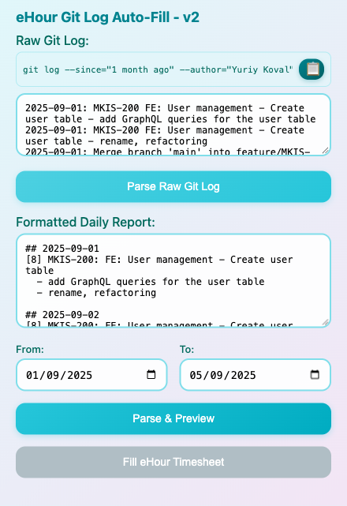

# eHour Git Log Auto-Fill Chrome Extension

> **Archived.** Superseded by [ehour-mcp](https://github.com/ykoval/ehour-mcp): an MCP server that
> drafts the timesheet from your git log, fills it in a real Chrome over CDP and reads every saved
> week back to verify it. This extension still works, but it is no longer maintained.

Automatically fill eHour timesheets from parsed git logs. This extension parses your daily development reports and fills your eHour timesheet entries automatically.



The screenshot and everything in [`examples/`](examples) use made-up tickets and commits.

## Features

- 📝 **Parse Git Logs**: Converts daily reports in the format `[8] MKIS-101: Task description...`
- 📅 **Date Range Selection**: Fill timesheets for specific weeks or months
- 🤖 **Auto-Fill**: Automatically fills eHour timesheet forms
- 🎯 **Smart Detection**: Detects eHour pages and timesheet structures
- 📊 **Preview**: Shows parsed data before filling
- 🔄 **Bulk Entry**: Process multiple days at once

## Installation

1. Open Chrome and navigate to `chrome://extensions/`
2. Enable "Developer mode" (toggle in top right)
3. Click "Load unpacked" and select this extension folder
4. The extension icon should appear in your Chrome toolbar

## Permissions

Chrome warns that the extension can "read and change all your data on all websites".
Here is what each permission is used for:

| Permission | Why |
|---|---|
| `activeTab` | Lets the popup act on the tab you have open when you click the extension icon |
| `scripting` | Injects `content.js` into that tab before filling, in case it is not loaded yet |
| `storage` | Keeps the raw git log, the formatted report and the date range between popup openings (`chrome.storage.local`, this browser only) |
| `host_permissions: *://*/*` | eHour is self-hosted, so its address is different for every company. This wildcard lets the extension work on any eHour host without editing the manifest |

The extension makes no network requests: nothing is sent anywhere, it only reads your
input and types into the eHour page. The content script runs automatically only on URLs
containing `/ehour/` or `/timesheet/`; on other pages it is injected only when you press
"Fill eHour Timesheet", and the popup refuses to fill a tab whose URL does not look like eHour.

To narrow the access to your own server, replace `*://*/*` in `manifest.json` with your
eHour host, for example `https://ehour.example.com/*`, and reload the extension.

## Usage

### 1. Prepare Your Daily Report

Create a daily report in this format:
```markdown
## 2025-07-01
[8] MKIS-101: Fix the delete confirmation dialog; MKIS-102: Fix the "Save and Continue" button

## 2025-07-02
[8] MKIS-103: Settings page - remove the unused add button

## 2025-07-03
[8] MKIS-104: Upload form - fix the "Save changes" button; MKIS-105: Add a store module
```

### 2. Fill Your Timesheet

1. Navigate to your eHour timesheet page
2. Click the extension icon in Chrome toolbar
3. Paste your daily report in the text area
4. Select the date range you want to fill
5. Click "Parse & Preview" to see what will be filled
6. Click "Fill eHour Timesheet" to automatically fill the forms

## How It Works

### Parsing Logic
- Extracts dates from `## YYYY-MM-DD` headers
- Extracts hours from `[X]` brackets (e.g., `[8]` = 8 hours)
- Identifies ticket numbers for project mapping. The project code is `MKIS`, set in
  `popup.js` and `content.js` (`findMKISProjectRow`); change it there for another eHour project
- Creates descriptions from task summaries

### Auto-Fill Process
1. **Page Detection**: Checks the URL, the page title and eHour-specific elements
2. **Project Row**: Finds the timesheet row whose project code is `MKIS`
3. **Hours**: Types the hours into the day column that matches each date
4. **Comments**: Opens the day's comment dialog and writes the task description and subtasks
5. **Save**: Clicks eHour's own save button for each week it filled

The extension saves the week by itself, so check the preview before pressing
"Fill eHour Timesheet".

## Supported eHour Versions

Built against the standard eHour web timesheet (project rows, per-day hour inputs and the
pencil icon that opens the day comment). A custom eHour skin with different markup will
need the selectors in `content.js` adjusted. See [docs/DEVELOPMENT.md](docs/DEVELOPMENT.md).

## Troubleshooting

### Extension Not Working?
1. Check that you're on an eHour timesheet page
2. Ensure the page has loaded completely
3. Check browser console for error messages
4. Try refreshing the page and running again

### Data Not Parsing?
1. Verify your daily report follows the correct format
2. Ensure dates are in `YYYY-MM-DD` format
3. Check that hours are in `[X]` brackets
4. Make sure each day starts with `## Date`

### Form Not Filling?
1. The extension tries to detect common eHour form structures
2. If your eHour installation uses custom fields, the extension may need updates
3. Check the browser console for detection logs
4. Try manually clicking on form fields first

## Development

See [docs/DEVELOPMENT.md](docs/DEVELOPMENT.md) for the file layout, the data flow and how
to adapt the extension to another eHour project. To try the parser on the sample log:

```bash
node reformat_gitlog.js examples/raw-git-log.txt /tmp/report.txt
```

## Contributing

1. Fork the repository
2. Make your changes
3. Test with your eHour installation
4. Submit a pull request

## License

[MIT](LICENSE)

## Version History

- **v1.0.0**: Initial release with basic parsing and filling functionality
